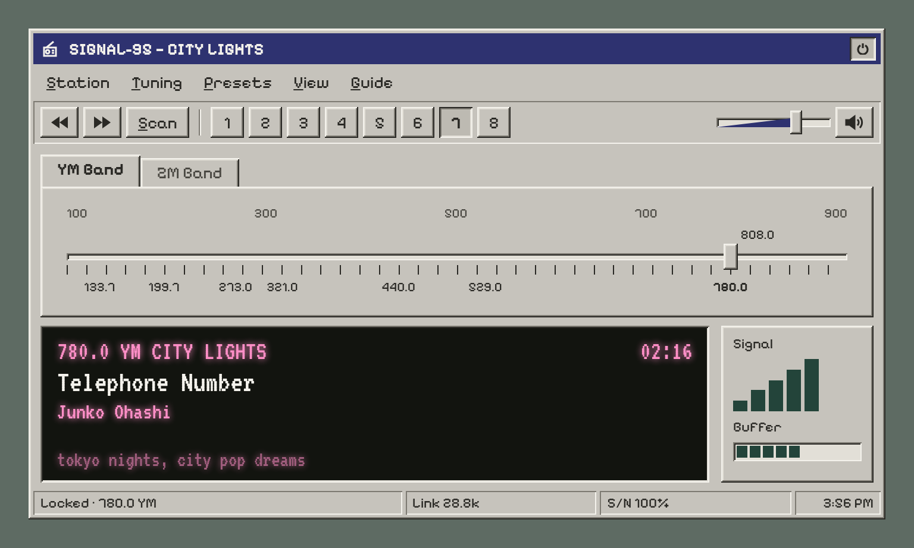
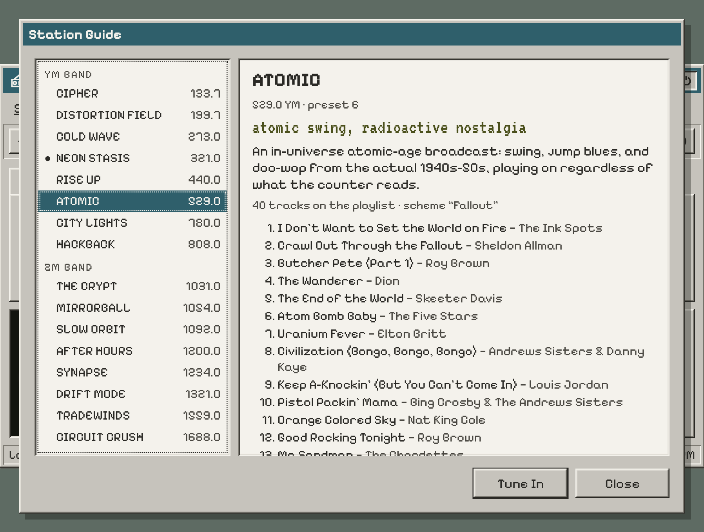
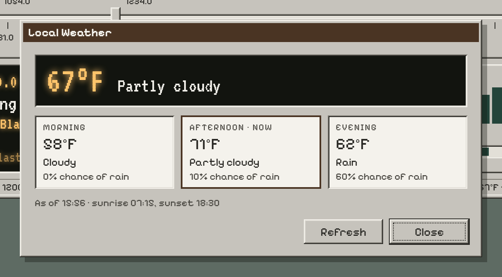
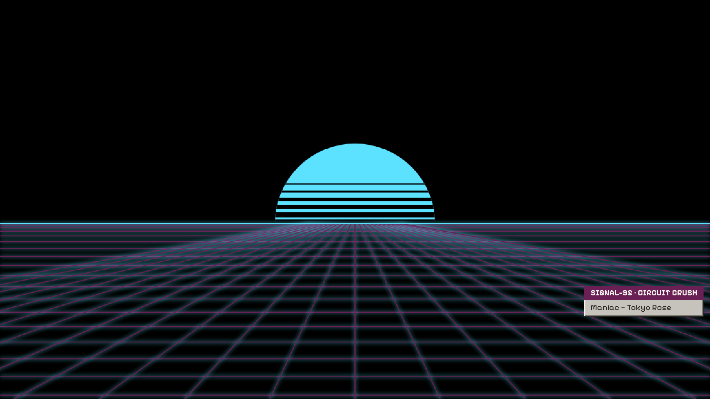
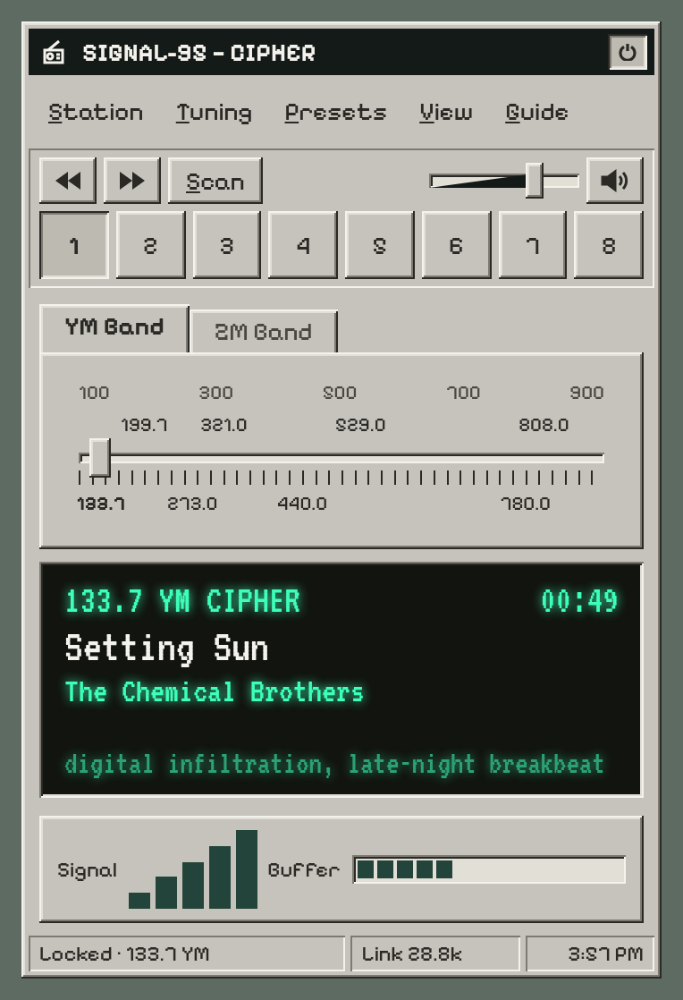

# SIGNAL-95

An internet-radio tuner with the look and feel of a mid-90s desktop
application. It plays the same sixteen curated stations as
[SIGNAL](https://hyphen8d.github.io/signal/), across the same two bands, and
it reads SIGNAL's roster live, so the two radios always carry the same
music.

SIGNAL is a radio on a CRT terminal. SIGNAL-95 is its sibling: same bones,
same stations, a different decade.



| | |
|---|---|
|  |  |
|  |  |

Screenshots are generated by `npm run shoot`, not taken by hand.

## Controls

Everything works with the mouse, and everything has a key.

| Mouse | Key | Does |
|---|---|---|
| Power button, top right | `P` | Power on / off |
| Click or drag the dial | `←` `→` (Shift for fine) | Tune |
| Mouse wheel over the dial | (Shift for fine) | Nudge the tuning |
| Seek buttons | `↑` `↓` | Jump to the next / previous station |
| Preset buttons | `1–9` | Tune a preset on this band |
| Tuning → Lock On | `Enter` | Lock on to the signal in range, dead centre |
| Station → Next Track | `N` | Skip to the next track on this station |
| Band tabs | `B` | Switch between YM and ZM |
| Scan | `S` | Visit each station in turn |
| Volume slider (press, drag or wheel) | `−` `+` | Volume down / up |
| Speaker button | `M` | Mute |
| Station → Sleep timer | `T` | Sleep in 60, 30, 15 minutes, or off; fades out, then switches off |
| Right-click a preset | `Shift+F10` | Preset menu: tune, station info, copy link |
| Station → Share What’s Playing | `K` | Copy the song, the station and a link that plays it |
| View → Lyrics | `L` | Show the words on the display, in time |
| View → Weather | `W` | The local forecast (asks first) |
| View → Screensaver | `V` | Screensaver now (any key or mouse movement returns) |
| Guide → Station Guide | `G` | Browse the stations and their playlists |
| Menu bar | `Alt+letter` `F10` | Open a menu (arrows move, Enter chooses, Esc closes) |

## Running it locally

No build step and no dependencies. SIGNAL must be checked out beside this
repo, since the roster comes from it:

```bash
git clone https://github.com/hyphen8d/signal.git
git clone <this repo> signal-95
cd signal-95
npm run dev        # http://127.0.0.1:8095/signal-95/
npm test
```
